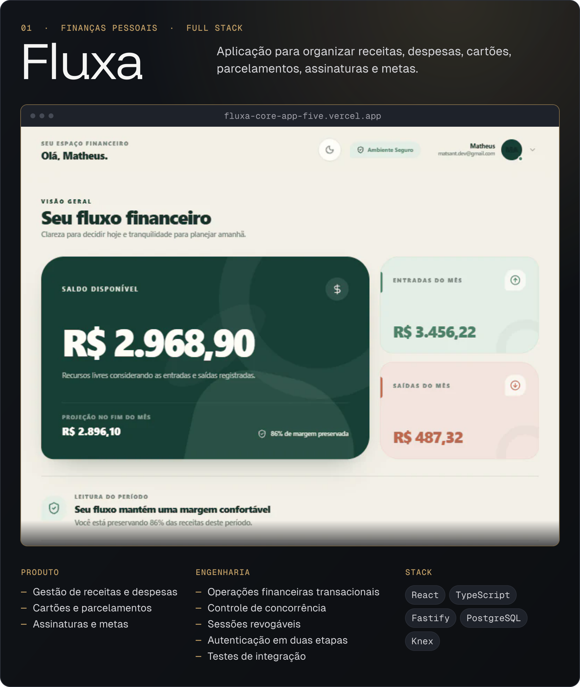
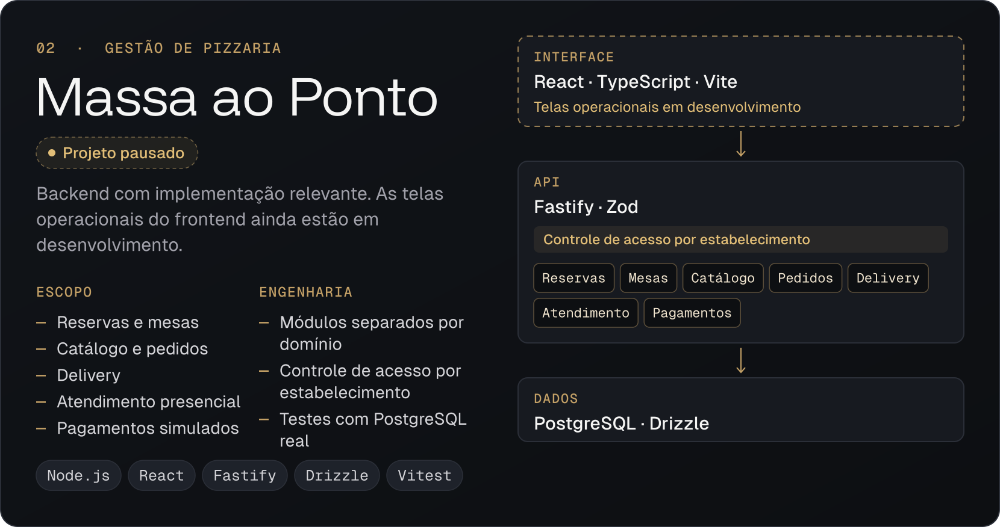
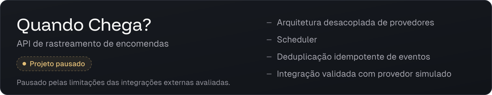
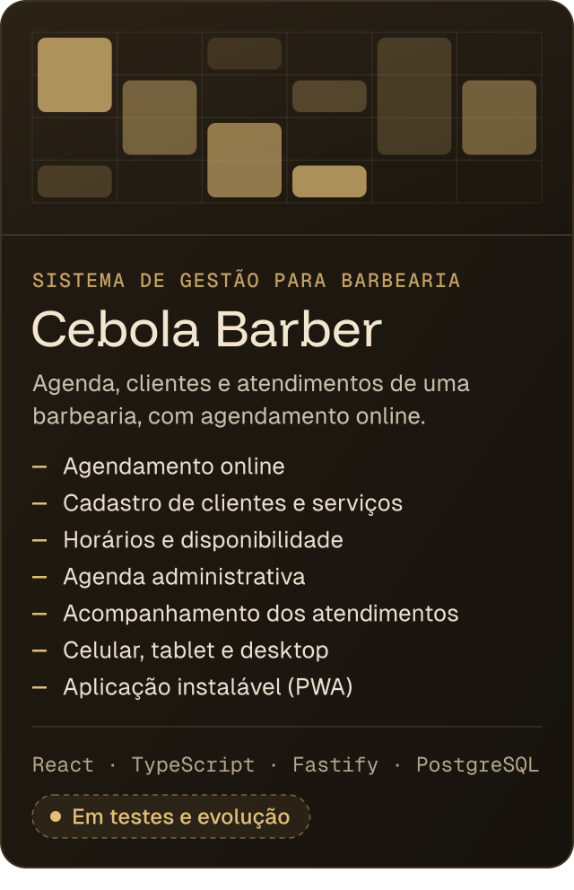
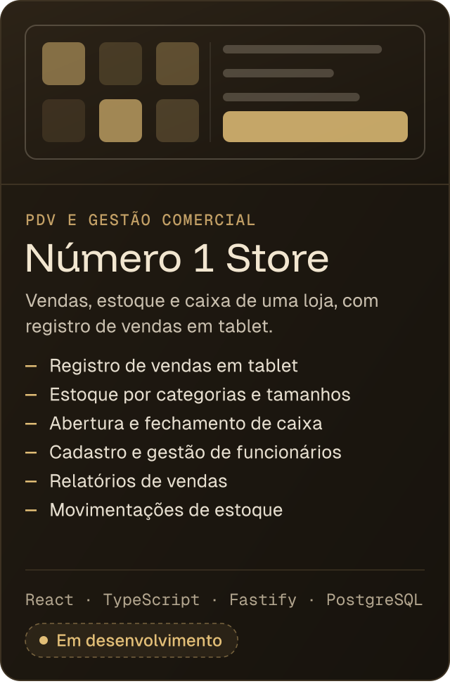
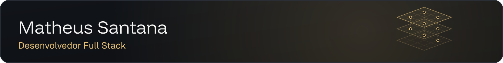

<picture>
  <source media="(max-width: 1100px)" srcset="./assets/profile-banner-mobile.svg">
  
</picture>

  

&nbsp;
&nbsp;

 

<h3></h3>

Sou desenvolvedor Full Stack, com foco em **JavaScript, TypeScript, React e Node.js**. Desenvolvo projetos próprios e sistemas para clientes.

Trabalho com frontend, backend, APIs REST, autenticação, bancos de dados relacionais e testes. Antes de atuar com desenvolvimento, trabalhei com suporte técnico, redes e sistemas.

Curso **Análise e Desenvolvimento de Sistemas** na UniSantos.

 

<h3></h3>

<a href="https://fluxa-core-app-five.vercel.app/">
  <picture>
    <source media="(max-width: 1100px)" srcset="./assets/project-fluxa-mobile.svg">
    
  </picture>
</a>

 

  &nbsp;
  

 

<a href="https://github.com/matssgit/massa-ao-ponto">
  <picture>
    <source media="(max-width: 1100px)" srcset="./assets/project-massa-mobile.svg">
    
  </picture>
</a>

 

  

 

<a href="https://github.com/matssgit/quando-chega">
  <picture>
    <source media="(max-width: 1100px)" srcset="./assets/project-quando-chega-mobile.svg">
    
  </picture>
</a>

  

<h3></h3>

As artes acima são ilustrativas. Partes do código e os dados de clientes são privados.

 

<h3></h3>

<picture>
  <source media="(max-width: 1100px)" srcset="./assets/stack-mobile.svg">
  
</picture>

  

<picture>
  <source media="(max-width: 1100px)" srcset="./assets/footer-mobile.svg">
  
</picture>

 

&nbsp;
&nbsp;

