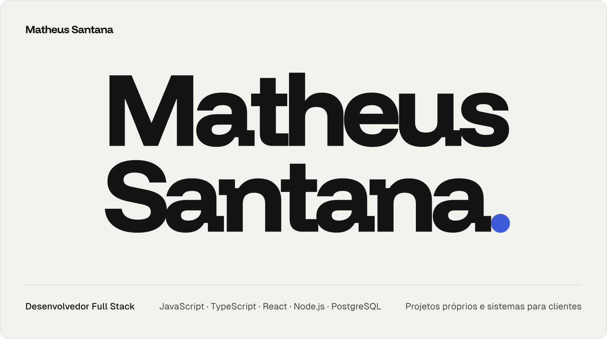
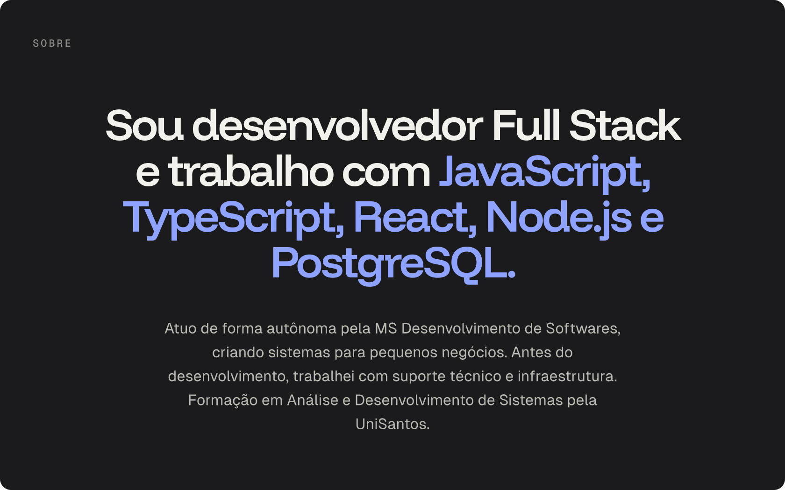
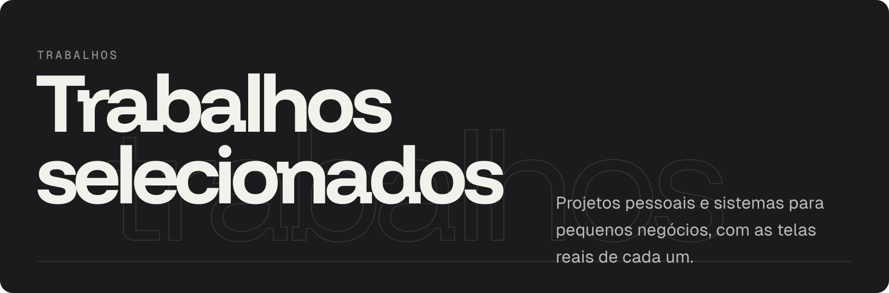
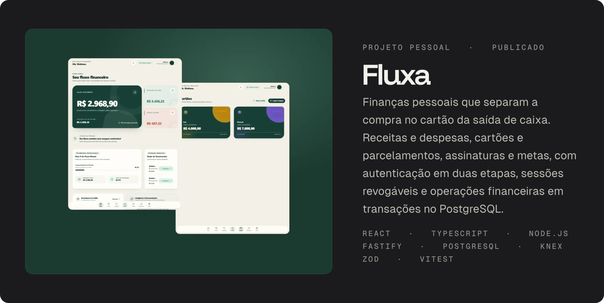
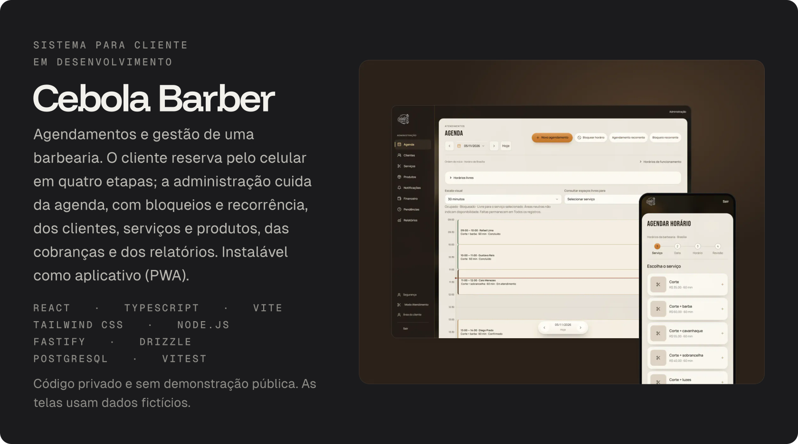
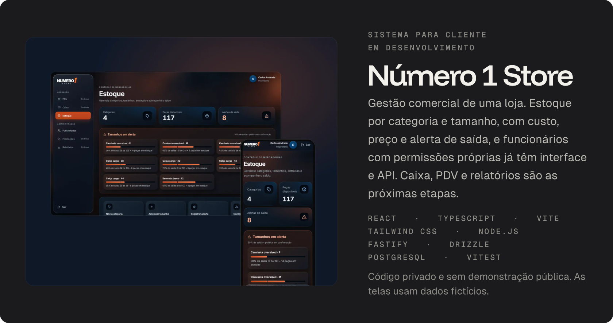
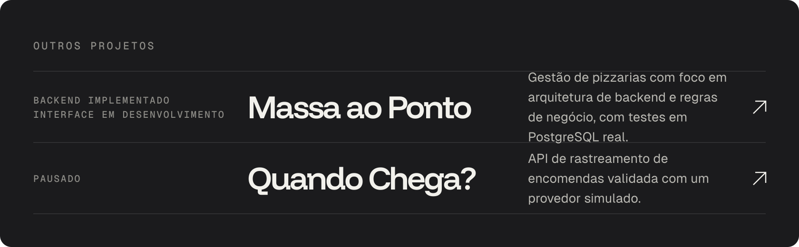
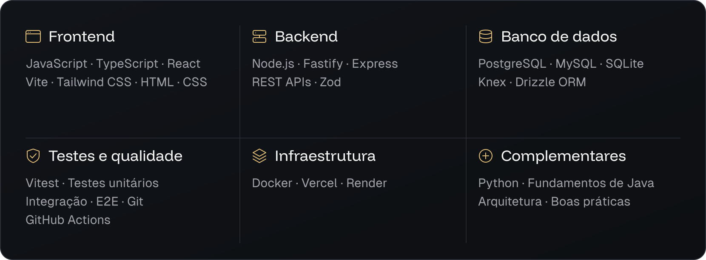
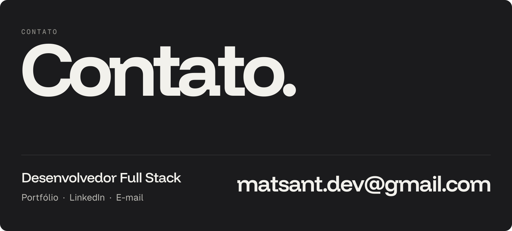

<picture>
  <source media="(max-width: 1100px)" srcset="./assets/hero-mobile.svg">
  
</picture>

<a href="https://matheusantanadev.vercel.app/">Portfólio</a> &nbsp;·&nbsp; <a href="https://www.linkedin.com/in/matheussantanadev">LinkedIn</a> &nbsp;·&nbsp; <a href="mailto:matsant.dev@gmail.com">E-mail</a>

<picture>
  <source media="(max-width: 1100px)" srcset="./assets/sobre-mobile.svg">
  
</picture>

<picture>
  <source media="(max-width: 1100px)" srcset="./assets/trabalhos-mobile.svg">
  
</picture>

<a href="https://fluxa-core-app-five.vercel.app/">
<picture>
  <source media="(max-width: 1100px)" srcset="./assets/work-fluxa-mobile.svg">
  
</picture>
</a>

<a href="https://fluxa-core-app-five.vercel.app/">Abrir aplicação</a> &nbsp;·&nbsp; <a href="https://github.com/matssgit/fluxa-app">Código no GitHub</a>

<picture>
  <source media="(max-width: 1100px)" srcset="./assets/work-cebola-mobile.svg">
  
</picture>

<picture>
  <source media="(max-width: 1100px)" srcset="./assets/work-numero1-mobile.svg">
  
</picture>

<a href="https://github.com/matssgit/massa-ao-ponto">
<picture>
  <source media="(max-width: 1100px)" srcset="./assets/outros-mobile.svg">
  
</picture>
</a>

<a href="https://github.com/matssgit/massa-ao-ponto">Massa ao Ponto no GitHub</a> &nbsp;·&nbsp; <a href="https://github.com/matssgit/quando-chega">Quando Chega? no GitHub</a>

<picture>
  <source media="(max-width: 1100px)" srcset="./assets/stack-mobile.svg">
  
</picture>

<picture>
  <source media="(max-width: 1100px)" srcset="./assets/contato-mobile.svg">
  
</picture>

<a href="https://matheusantanadev.vercel.app/">Portfólio</a> &nbsp;·&nbsp; <a href="https://www.linkedin.com/in/matheussantanadev">LinkedIn</a> &nbsp;·&nbsp; <a href="mailto:matsant.dev@gmail.com">E-mail</a>

