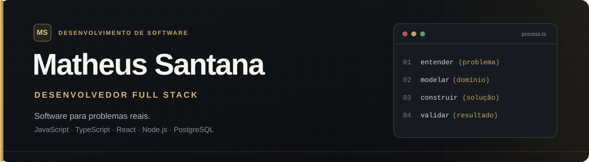
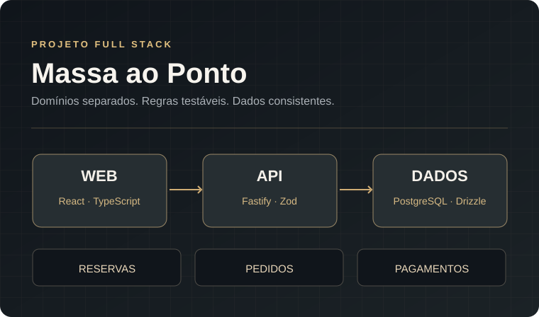

 

  

`Full Stack` &nbsp;•&nbsp; `JavaScript / TypeScript` &nbsp;•&nbsp; `Node.js / React`

---

### 01 / Sobre

Sou desenvolvedor Full Stack, com foco em **JavaScript, TypeScript, React e Node.js**. Desenvolvo projetos próprios e sistemas sob demanda para clientes.

Trabalho com frontend, APIs, autenticação, bancos de dados relacionais e testes. Antes de atuar com desenvolvimento, trabalhei com suporte técnico, redes e sistemas.

Curso **Análise e Desenvolvimento de Sistemas na UniSantos**.

 

### 02 / Projetos selecionados

<table>
<tr>
<td width="54%" valign="middle">
  
</td>
<td width="46%" valign="top">

#### 01 — FLUXA

**Finanças pessoais · Full Stack**

Aplicação para organizar receitas, despesas, cartões, parcelamentos, assinaturas e metas.

O projeto inclui operações financeiras com transações e controle de concorrência, sessões revogáveis, autenticação em duas etapas e testes de integração.

`React` `TypeScript` `Fastify` `PostgreSQL` `Knex`

**[↗ Aplicação](https://fluxa-core-app-five.vercel.app/)** &nbsp;·&nbsp; **[Código](https://github.com/matssgit/fluxa-app)**

</td>
</tr>
<tr>
<td width="54%" valign="middle">
  
</td>
<td width="46%" valign="top">

#### 02 — MASSA AO PONTO

**Gestão de pizzaria · Em desenvolvimento**

Sistema para reservas, mesas, catálogo, pedidos, delivery, atendimento presencial e pagamentos simulados.

O backend tem módulos separados por domínio, controle de acesso por estabelecimento e testes com PostgreSQL real. As telas operacionais do frontend ainda estão em desenvolvimento.

`Node.js` `React` `Fastify` `Drizzle` `Vitest`

**[↗ Explorar repositório](https://github.com/matssgit/massa-ao-ponto)**

</td>
</tr>
</table>

<b>+ Outro projeto de engenharia de software</b>

 

**[Quando Chega?](https://github.com/matssgit/quando-chega)** — API de rastreamento de encomendas com arquitetura desacoplada de provedores externos, scheduler e deduplicação idempotente de eventos. O núcleo foi validado com um provedor simulado; o desenvolvimento está pausado por limitações das integrações externas avaliadas.

`TypeScript` · `Fastify` · `PostgreSQL` · `Knex` · `Docker`

 

### 03 / Projetos para clientes

Também desenvolvo sistemas para pequenos negócios. Atualmente trabalho nestes dois projetos:

<table>
<tr>
<td width="50%" valign="top">

#### ✂️ Cebola Barber

**Sistema de gestão para barbearia**

Agendamento online, cadastro de clientes e serviços, configuração de horários, agenda administrativa e acompanhamento dos atendimentos. Interface para celular, computador e tablet.

</td>
<td width="50%" valign="top">

#### 🛍️ Número 1 Store

**PDV e gestão de loja**

Registro de vendas em tablet, estoque por categoria e tamanho, abertura e fechamento de caixa, cadastro de funcionários e relatórios de vendas.

</td>
</tr>
</table>

As soluções comerciais estão em desenvolvimento e evolução conforme as necessidades dos clientes. Partes do código e dados operacionais não são públicos.

 

### 04 / Stack & ferramentas

  

| Área | Tecnologias |
|:--|:--|
| **Frontend** | JavaScript, TypeScript, React, Vite, Tailwind CSS, HTML e CSS |
| **Backend** | Node.js, Fastify, Express, APIs REST, Zod |
| **Dados** | PostgreSQL, SQL, MySQL, SQLite, Knex, Drizzle ORM |
| **Qualidade** | Vitest, testes unitários, de integração e E2E, Git e GitHub Actions |
| **Infraestrutura** | Docker, Vercel, Render |
| **Estudos complementares** | Python, fundamentos de Java, arquitetura e boas práticas |

 

