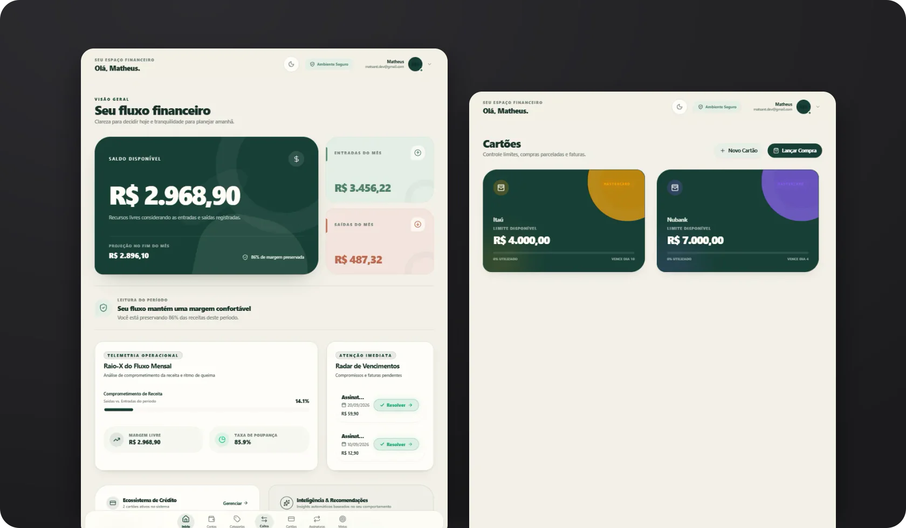
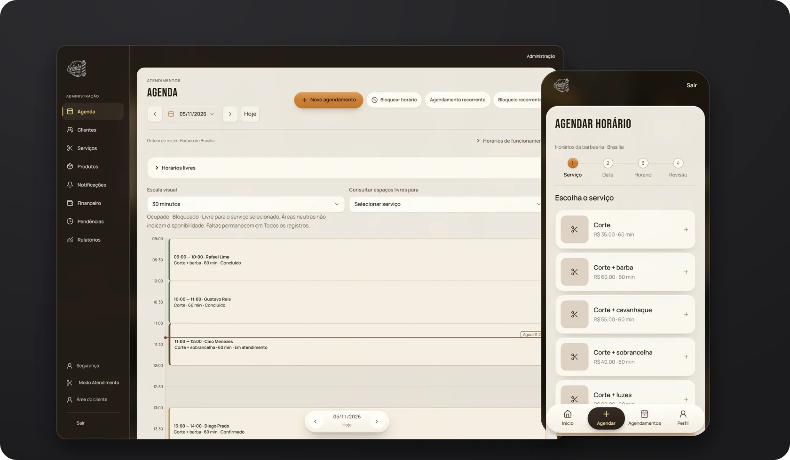
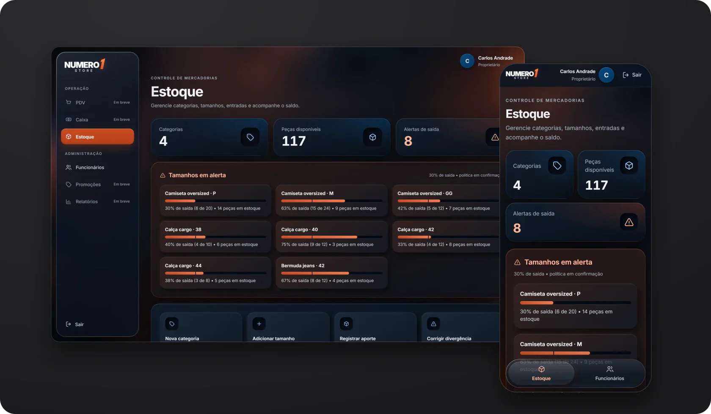

<picture>
  <source media="(prefers-color-scheme: dark)" srcset="./assets/banner-dark.svg">
  <source media="(prefers-color-scheme: light)" srcset="./assets/banner-light.svg">
  
</picture>

  

**Desenvolvedor Full Stack** 
JavaScript · TypeScript · React · Node.js · PostgreSQL

[Portfólio](https://matheusantanadev.vercel.app/) &nbsp;·&nbsp; [LinkedIn](https://www.linkedin.com/in/matheussantanadev) &nbsp;·&nbsp; [E-mail](mailto:matsant.dev@gmail.com)

 

<h3>
  <picture>
    <source media="(prefers-color-scheme: dark)" srcset="./assets/title-sobre-dark.svg">
    <source media="(prefers-color-scheme: light)" srcset="./assets/title-sobre-light.svg">
    
  </picture>
</h3>

Sou desenvolvedor Full Stack e trabalho com JavaScript, TypeScript, React, Node.js e PostgreSQL. Atuo de forma autônoma pela MS Desenvolvimento de Softwares, criando sistemas para pequenos negócios.

Antes do desenvolvimento, trabalhei com suporte técnico e infraestrutura. Formação em Análise e Desenvolvimento de Sistemas pela UniSantos.

 

<h3>
  <picture>
    <source media="(prefers-color-scheme: dark)" srcset="./assets/title-trabalhos-dark.svg">
    <source media="(prefers-color-scheme: light)" srcset="./assets/title-trabalhos-light.svg">
    
  </picture>
</h3>

PROJETO PESSOAL · PUBLICADO

### Fluxa

Finanças pessoais que separam a compra no cartão da saída de caixa. Receitas e despesas, cartões e parcelamentos, assinaturas e metas, com autenticação em duas etapas, sessões revogáveis e operações financeiras em transações no PostgreSQL.

React · TypeScript · Node.js · Fastify · PostgreSQL · Knex · Zod · Vitest

**[Abrir aplicação](https://fluxa-core-app-five.vercel.app/)** &nbsp;·&nbsp; **[Código no GitHub](https://github.com/matssgit/fluxa-app)**

 

SISTEMA PARA CLIENTE · EM DESENVOLVIMENTO

### Cebola Barber

Agendamentos e gestão de uma barbearia. O cliente reserva pelo celular em quatro etapas; a administração cuida da agenda, com bloqueios e recorrência, dos clientes, serviços e produtos, das cobranças e dos relatórios. Instalável como aplicativo (PWA).

React · TypeScript · Vite · Tailwind CSS · Node.js · Fastify · Drizzle · PostgreSQL · Vitest

Código privado e sem demonstração pública. As telas usam dados fictícios.

 

SISTEMA PARA CLIENTE · EM DESENVOLVIMENTO

### Número 1 Store

Gestão comercial de uma loja. Estoque por categoria e tamanho, com custo, preço e alerta de saída, e funcionários com permissões próprias já têm interface e API. Caixa, PDV e relatórios são as próximas etapas.

React · TypeScript · Vite · Tailwind CSS · Node.js · Fastify · Drizzle · PostgreSQL · Vitest

Código privado e sem demonstração pública. As telas usam dados fictícios.

 

PROJETO PESSOAL · BACKEND IMPLEMENTADO, INTERFACE EM DESENVOLVIMENTO

### Massa ao Ponto

Gestão de pizzarias com foco em arquitetura de backend e regras de negócio: delivery, atendimento no local, catálogo, mesas, reservas e pagamentos simulados, em módulos por domínio com acesso por estabelecimento e testes em PostgreSQL real.

**[Código no GitHub](https://github.com/matssgit/massa-ao-ponto)**

 

**Também no GitHub:** [Quando Chega?](https://github.com/matssgit/quando-chega), API de rastreamento de encomendas validada com um provedor simulado. Projeto pausado.

 

<h3>
  <picture>
    <source media="(prefers-color-scheme: dark)" srcset="./assets/title-tecnologias-dark.svg">
    <source media="(prefers-color-scheme: light)" srcset="./assets/title-tecnologias-light.svg">
    
  </picture>
</h3>

**Frontend** 
JavaScript · TypeScript · React · HTML · CSS · Tailwind CSS

**Backend** 
Node.js · Fastify · Express · APIs REST

**Banco de dados** 
PostgreSQL · MySQL · SQLite · Knex · Drizzle

**Ferramentas e testes** 
Git · GitHub · Docker · Vitest · Testes de integração

 

<h3>
  <picture>
    <source media="(prefers-color-scheme: dark)" srcset="./assets/title-contato-dark.svg">
    <source media="(prefers-color-scheme: light)" srcset="./assets/title-contato-light.svg">
    
  </picture>
</h3>

Portfólio &nbsp; [matheusantanadev.vercel.app](https://matheusantanadev.vercel.app/) 
LinkedIn &nbsp; [in/matheussantanadev](https://www.linkedin.com/in/matheussantanadev) 
E-mail &nbsp; [matsant.dev@gmail.com](mailto:matsant.dev@gmail.com)
